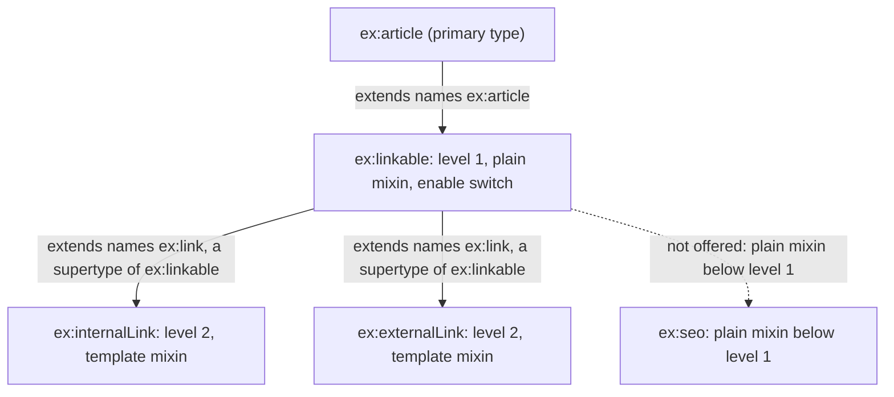

# Editor Form Fields

## Optional Fieldsets from Mixin Extensions

A mixin of a CND file can declare `extends = <type>`. Content Editor then offers that mixin as an optional fieldset on the form of a node of that type. The editor turns the fieldset on to apply the mixin, and turns it off to remove the mixin.

### Two kinds of optional fieldset

- **Plain mixin**: the fieldset has an enable switch. The editor turns the mixin on and off with that switch.
- **Template mixin**: the mixin inherits `jmix:templateMixin`, and its fieldset has no enable switch. A choicelist value with an `addMixin` property turns it on.

When the editor selects such a choicelist value, the form turns the template mixin on and shows its fields below the choicelist field. When the editor selects another value, the form turns the first template mixin off. The form also turns the template mixin off when the choicelist field leaves the form. This happens, for example, when the editor turns off the fieldset that holds the choicelist.

### Which mixins the form offers

The form collects the optional fieldsets in levels:

1. Level 1 holds every mixin whose `extends` names the primary type of the node or one of its supertypes. Plain mixins and template mixins both count.
2. The next level holds every template mixin whose `extends` names a mixin of the level above or one of its supertypes. The form repeats this step until it finds no new template mixin.
3. At every level, on a site, a mixin counts only when it comes from a system module, from a module enabled on the site, or from a dependency of such a module. A mixin that no module declares always counts, and a form built outside a site counts every mixin.

The edit form of a node can also start from a mixin applied to the node:

- A mixin that declares no `extends`, or that the primary type inherits, has a fieldset that is not optional, so the editor cannot remove it. Such a mixin counts like the primary type: the mixins whose `extends` names it or one of its supertypes join level 1.
- Any other applied mixin is optional, and the form does not start from it. Such a mixin is either on the form already, through the walk from the primary type, or it is applied outside its `extends`. In the second case, its inherited choicelist can stay on the form after the editor turns the mixin off.

The form does not offer a plain mixin below level 1.

The definitions below show the three cases. `ex:article` is the primary type, and the `ex:link` mixin holds a choicelist whose values add `ex:internalLink` or `ex:externalLink`.

```text
[ex:article] > jnt:content

[ex:link] mixin
 - linkType (string, choicelist[linkTypeInitializer])

[ex:linkable] > ex:link mixin
 extends = ex:article

[ex:internalLink] > jmix:templateMixin mixin
 extends = ex:link
 - internalLink (weakreference)

[ex:externalLink] > jmix:templateMixin mixin
 extends = ex:link
 - externalLink (string)

[ex:seo] mixin
 extends = ex:link
 - seoTitle (string)
```



The form of an `ex:article` node shows an enable switch for `ex:linkable`. When the editor turns `ex:linkable` on, the `linkType` choicelist appears, and its values turn `ex:internalLink` or `ex:externalLink` on. The walk through `ex:linkable` never offers `ex:seo`. Only an `ex:link` applied to the node directly brings `ex:seo` in, at level 1.

### Why the form offers template mixins below level 1

A choicelist can only turn on a template mixin whose fieldset is on the form. If the form stopped at level 1, the template mixins that extend a level-1 mixin would have no fieldset. In the example, the editor turns `ex:linkable` on and selects a link type, and the form shows no link field. The save then does not apply `ex:internalLink` or `ex:externalLink`.

A template mixin below level 1 is safe to offer, because it has no enable switch. Only a choicelist in the fieldset of its base mixin turns it on, and that choicelist appears only while the base mixin is on.

### Why the form does not offer plain mixins below level 1

An optional fieldset carries no link to the mixin that its `extends` names. A plain mixin below level 1 would therefore get its own enable switch at the top of the form. That switch would show while the base mixin is off. In the example, the editor could turn `ex:seo` on with `ex:linkable` off and save a node that carries `ex:seo` but is not an `ex:link`. The `extends` of `ex:seo` does not allow that node, and the repository does not check it.

The form leaves out such a plain mixin even while its base mixin is on. To offer such a mixin, each fieldset would have to carry the mixin it depends on. The form could then tie the switch of the fieldset to the switch of that mixin.

### Duplicate switches

When another level-1 mixin, plain or template, inherits a level-1 plain mixin, the form drops the inherited mixin. The other mixin already carries its fields, and a second switch over the same fields would have no purpose.

The form never drops a template mixin. A template mixin has no switch, and a chain of template mixins can have each member as a value of one choicelist.

The template mixins below level 1 do not take part in this check. When a template mixin below level 1 inherits a level-1 plain mixin, the form keeps the switch of the plain mixin. That switch is the only way to turn the plain mixin on. A definition like this one is the pattern that the next section tells you to avoid.

### Do not make a template mixin inherit its base mixin

A template mixin extends its base mixin with `extends`. Do not also make it inherit that mixin with `>`. The fieldset of a template mixin holds every property it inherits. When the choicelist of the base mixin turns such a template mixin on, the form shows each property of the base mixin twice, and the save keeps only one of the two values.

```text
// Do this
[ex:internalLink] > jmix:templateMixin mixin
 extends = ex:link

// Not this
[ex:internalLink] > jmix:templateMixin, ex:link mixin
 extends = ex:link
```
